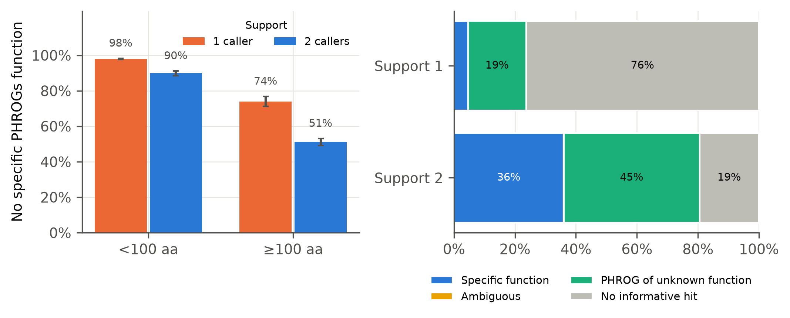

# PhageAnnoScope

**Inter-tool disagreement in bacteriophage gene calling and functional uncertainty of phage proteins**

PhageAnnoScope is a reproducible comparison of the structural and functional annotation of 17,882 complete or high-quality genomes of DNA phages that infect bacteria (INPHARED2 / NCBI GenBank). CDS predicted by PHANOTATE and Pyrodigal-gv are compared with GenBank by exact coordinates and shared stop codons. Proteins are annotated with PHROGs v4 HMMs, and a probability sample is also annotated with Phold. The statistics use cluster-robust GEE, which accounts for relatedness between phages.

## Key results

Full cohort: 17,862 genomes in the primary analysis, 2,300,621 stop-loci, 4,490 relatedness blocks.

| Result | Value |
|---|---|
| Agreement (stop-codon Jaccard) | GenBank–Pyrodigal-gv 0.880; GenBank–PHANOTATE 0.798; PHANOTATE–Pyrodigal-gv 0.808 |
| **H1:** support and function | No specific function in 95.3% of single-caller ORFs vs 64.0% of two-caller ORFs; adjusted OR 0.49 (95% CI 0.43–0.56); robust to PHROGs thresholds and length strata |
| **H2:** length and overlaps | Single-caller support in 38.9% of ORFs < 100 aa vs 3.7% of longer ORFs; antisense overlap OR 43.9 |
| **H3:** Phold | Function assigned to 18.2% (14.8–22.3%) of sampled proteins lacking one, mostly ≥ 100 aa |
| **H4:** ORFs absent from GenBank | 6,399 ORFs in 3,986 fully annotated genomes match characterised PHROGs, mostly DNA metabolism and lysis |
| GenBank "hypothetical" proteins | 65.9% of GenBank CDS; 13.9% of them have a specific PHROGs function |



*Figure 4. Share of ORFs without a specific PHROGs function, split by caller support (left: by length class, 95% cluster-bootstrap CI) and the full functional status breakdown (right).*

The full numbers are in [`docs/RESULTS.md`](docs/RESULTS.md), and all figures are in [`figures/`](figures/).

## Repository layout

| Path | Content |
|---|---|
| `src/phageannoscope/` | Pipeline package: GenBank import, gene-caller adapters, CDS matching, storage, validation |
| `scripts/cohort/` | Cohort metadata, host-domain resolution, protocol amendments |
| `scripts/phrogs/` | Building the PHROGs HMMER3 library; cached protein search |
| `scripts/pipeline/` | Batch runner, resource guard, checkpoint rebuild, merging of batches, post-processing |
| `scripts/analysis/` | Hypothesis statistics (GEE, cluster bootstrap), robustness, descriptive statistics, figures, Phold |
| `scripts/reproducibility/` | Cross-machine check with reference calls |
| `tests/` | Automated tests (`pytest`) |
| `configs/` | Prespecified protocol parameters and run configurations |
| `environment/` | Conda environment files with pinned versions |
| `docs/` | Protocol and amendments, reproduction guide, results, references |
| `manifests/` | Validated cohort manifest, accession lists of the nested batches, checksums |
| `results/` | Final statistics, descriptive tables, robustness analyses, Phold results |
| `figures/` | Figures 1–11 (PNG, SVG, PDF) |

## Quick start

```bash
git clone https://github.com/rarltyD/PhageAnnoScope.git && cd PhageAnnoScope
conda env create -f environment/environment.yml && conda activate phageannoscope
python -m venv --system-site-packages .venv && .venv/bin/pip install --no-deps -e .
.venv/bin/python -m pytest -q        # PHANOTATE integration tests need PHAGEANNOSCOPE_TEST_CONFIG
```

The complete workflow, from cohort selection to figures, is described in [`docs/REPRODUCE.md`](docs/REPRODUCE.md).

## Data not included

The raw GenBank records (~4 GB), caller outputs and per-locus tables (tens of GB) are not stored here. They can be regenerated from public sources with the accession lists in `manifests/` and the steps in [`docs/REPRODUCE.md`](docs/REPRODUCE.md).

## Methods in brief

The protocol was registered before analysis; all later changes are dated amendments with rationale in [`docs/PROTOCOL.md`](docs/PROTOCOL.md).

- **Tool versions:** PHANOTATE 1.6.7, Pyrodigal-gv 0.3.2 / Pyrodigal 3.7.1, Biopython 1.88, pyhmmer 0.12.3 with PHROGs v4 (rebuilt as HMMER3 profiles), Phold 1.2.6 / Foldseek 10.941cd33.
- **Reproducibility check:** 17 genomes recomputed from scratch on a second machine gave 7,247/7,247 identical CDS calls.

## Citation

See [`CITATION.cff`](CITATION.cff).

## Contact

T.T. Kerimov — kerimov03.t14@gmail.com

## License

The code is released under the MIT License. The underlying data come from public databases (NCBI GenBank, INPHARED2, PHROGs) and remain subject to their own terms.
