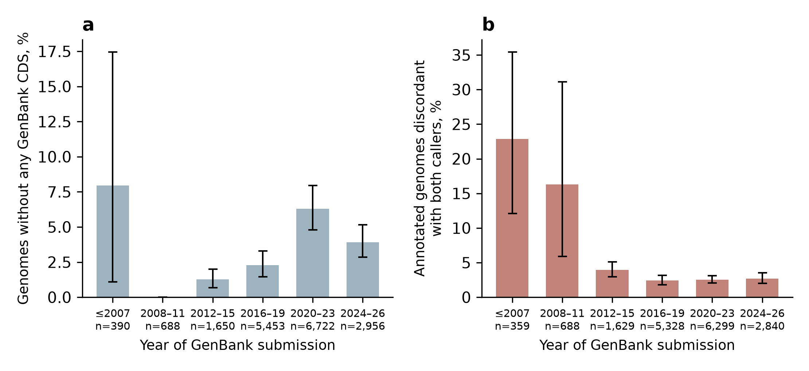
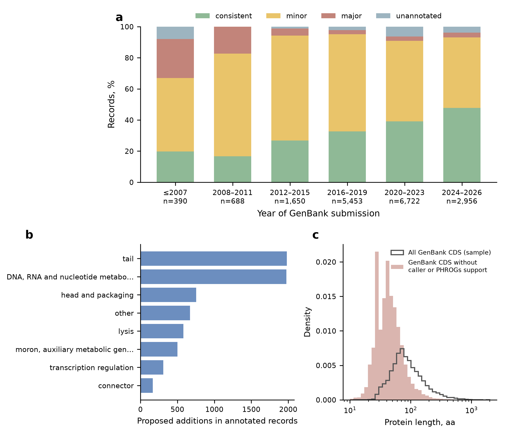

# Results of the exploratory analyses

Record age (E1) and consensus re-annotation (E2), as defined in [`PROTOCOL.md`](PROTOCOL.md). Both were added after the primary analysis. Numbers come from `results/record_age/` and `results/reannotation/`.

## E1. Record age and discordance with both callers

17,859 genomes (3 without a submission date excluded), 4,490 relatedness blocks. The submission year differs from the LOCUS year (last modification) in 53% of records.

| Measure | n | Share |
|---|---:|---:|
| Discordant with both callers (stop-set Jaccard < 0.8) | 1,339 | 7.5% |
| Unannotated (no CDS deposited) | 716 | 4.0% |
| Annotated but discordant | 623 | 3.5% |

Discordant records have a median of 1.34 fewer CDS per kb than the callers: discordance is mostly missing annotation.

| Submission period | Genomes | Unannotated, % (95% CI) | Discordant among annotated, % (95% CI) |
|---|---:|---|---|
| ≤2007 | 390 | 7.9 (1.1–17.5) | 22.8 (12.1–35.4) |
| 2008–2011 | 688 | 0.0 | 16.3 (5.9–31.1) |
| 2012–2015 | 1,650 | 1.3 (0.7–2.0) | 3.9 (3.0–5.1) |
| 2016–2019 | 5,453 | 2.3 (1.5–3.3) | 2.4 (1.8–3.1) |
| 2020–2023 | 6,722 | 6.3 (4.8–8.0) | 2.5 (2.1–3.1) |
| 2024–2026 | 2,956 | 3.9 (2.9–5.2) | 2.7 (2.0–3.5) |

Adjusted odds ratios (logistic GEE; reference 2020–2023 and Illumina/Ion Torrent/MGI):

| Covariate | Unannotated record | Annotated but discordant |
|---|---|---|
| ≤2007 | 1.11 (0.40–3.10) | 5.64 (3.46–9.19) |
| 2008–2011 | no events | 4.23 (2.52–7.10) |
| 2012–2015 | 0.26 (0.13–0.54) | 1.41 (0.96–2.08) |
| 2016–2019 | 0.43 (0.25–0.74) | 1.00 (0.72–1.39) |
| 2024–2026 | 0.59 (0.39–0.90) | 1.03 (0.73–1.44) |
| Sanger | 1.57 (0.73–3.39) | 5.39 (2.40–12.11) |
| Long-read only | 1.57 (0.95–2.61) | 2.02 (1.12–3.62) |
| Hybrid short + long read | 7.29 (3.70–14.38) | 1.37 (0.39–4.81) |
| Genome length, per tenfold | 0.75 (0.44–1.30) | 0.28 (0.16–0.48) |
| Temperate vs lytic | 0.56 (0.40–0.80) | 0.62 (0.44–0.89) |

- Threshold 0.9: monotonic gradient with age (≤2007 OR 3.14; 2008–2011 1.99; 2012–2015 1.89; 2016–2019 1.24; 2024–2026 0.79).
- Without splitting the components, the linear trend is not significant (OR 0.89 per five years, 0.76–1.04): the two components change in opposite directions.
- Only 11% of records name a gene caller. Records naming Prodigal (1,453) or PHANOTATE (284) are rarely discordant (0.5% and 2.5%), as expected for the comparison callers or their relatives; Glimmer (64) 7.8%.

## E2. Consensus re-annotation

| Category | Genes | Records |
|---|---:|---:|
| GenBank CDS confirmed by both callers | 1,748,010 | |
| GenBank CDS supported by one caller | 138,632 | |
| GenBank-only CDS with a specific PHROGs function | 5,427 | |
| GenBank-only CDS without support (flagged) | 21,353 | 9,517 |
| Proposed additions in annotated records | 6,983 | 3,215 |
| Proposed additions in unannotated records | 26,717 | 716 |
| Two-caller ORFs ≥ 100 aa absent from GenBank, no specific function | 33,423 | |
| Start corrections | 69,379 | 12,685 |

- Flagged GenBank CDS are short: median 54 aa (IQR 39–82), 43% below 50 aa, versus a median of 128 aa for all GenBank CDS.
- Proposed additions in annotated records are mostly tail (1,981), DNA, RNA and nucleotide metabolism (1,974), head and packaging (754) and lysis proteins (580).
- Record classes: consistent 6,454 (36.1%), minor revision 9,982 (55.9%; 4,327 with a single gene), major revision 707 (4.0%; 623 from E1 discordance, 84 from the 10% rule), unannotated 716 (4.0%). Major revision at 5% / 20%: 1,266 / 627.
- Consistent records rise from 19.7% (≤2007) and 16.7% (2008–2011) to 47.7% (2024–2026).
- Flags also fall on genuine genes: in the RefSeq record of phage lambda (NC_001416.1), NinD and NinE of the *nin* region are flagged because neither caller predicts them and they have no specific PHROGs function.
- The consensus annotation of all records contains 2,006,768 genes.

## Output files

| File | Content |
|---|---|
| `results/record_age/record_metadata.csv.gz` | Per record: submission and modification dates, sequencing technology, annotation pipeline, CDS count, named gene caller |
| `results/record_age/genome_table.csv.gz` | Per genome: discordance components, submission period, relatedness block |
| `results/record_age/gee_models.csv`, `summary.json` | Model estimates and summary |
| `results/reannotation/records_reannotation.csv.gz` | Per record: gene-category counts, start corrections, re-annotation class |
| `results/reannotation/gene_proposals.csv.gz` | Per gene: flagged GenBank CDS, proposed additions and start corrections with coordinates and PHROGs annotation |
| `results/reannotation/consensus_annotation.gff3.gz` | Consensus annotation of all 17,859 records (GFF3, 1-based coordinates) |
